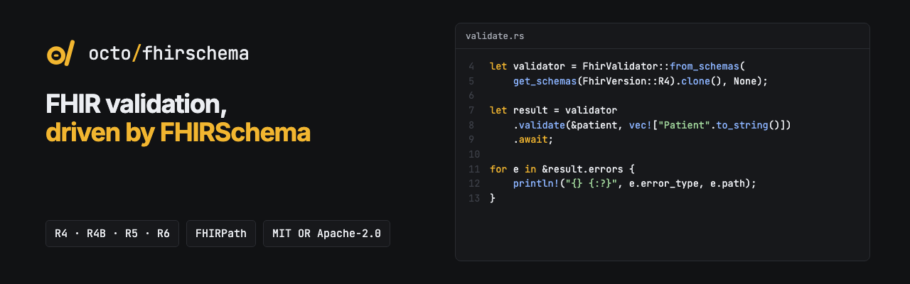

<p align="center"></p>

<p align="center"><b>FHIRSchema for Rust: convert StructureDefinitions and validate FHIR resources for R4, R4B, R5 and R6.</b></p>

<p align="center">
  <a href="https://github.com/octofhir/fhirschema-rs/actions/workflows/ci.yml"></a>
  <a href="https://crates.io/crates/octofhir-fhirschema"></a>
  <a href="https://docs.rs/octofhir-fhirschema"></a>
  <a href="#license"></a>
</p>

## Overview

This project provides:
- **Converter**: Transforms FHIR StructureDefinitions into FHIRSchema format
- **Validator**: Validates FHIR resources against FHIRSchema definitions  
- **Schema Generator**: CLI tool for generating precompiled schemas

## Project Structure

- **`octofhir-fhirschema`** - Main library crate with core functionality
- **`octofhir-fhirschema-devtools`** - Development tools including schema generator

## Installation

Add this to your `Cargo.toml`:

```toml
[dependencies]
octofhir-fhirschema = "0.3"
```

For embedded or caller-supplied schemas without HTTP clients:

```toml
[dependencies]
octofhir-fhirschema = { version = "0.3.34", default-features = false }
```

`http-client` is enabled by default to preserve the `DefaultTerminologyProvider`
export. Disable default features when you only need local model information,
conversion or validation. Terminology traits, in-memory services and caching stay
available without HTTP. Another dependency enabling `fhir-model/http-client` can
still add the HTTP client to the final build through Cargo feature unification.

The library does not depend on `canonical-manager`. Package downloads and schema
generation belong to the separate `octofhir-fhirschema-devtools` crate. Embedded
R4, R4B, R5 and R6 schemas are already generated and need no network access.

## Usage

### Converting StructureDefinition to FHIRSchema

```rust
use octofhir_fhirschema::{translate, StructureDefinition};

// Load your StructureDefinition
let structure_definition: StructureDefinition = serde_json::from_str(json_string)?;

// Convert to FHIRSchema
let schema = translate(structure_definition, None)?;

println!("Converted schema: {}", schema.name);
```

### Validating FHIR Resources

`FhirValidator` validates a resource against one or more schemas by name. The
precompiled core schemas for each FHIR version are embedded in the crate:

```rust
use octofhir_fhirschema::{FhirValidator, FhirVersion, get_schemas};

// Validator over the embedded R4 core schemas. Without a FHIRPath evaluator
// (the second argument), FHIRPath invariants are not checked.
let validator = FhirValidator::from_schemas(get_schemas(FhirVersion::R4).clone(), None);

let patient = serde_json::json!({
    "resourceType": "Patient",
    "id": "example",
    "active": true
});

let result = validator.validate(&patient, vec!["Patient".to_string()]).await;

if result.valid {
    println!("Resource is valid!");
} else {
    for error in &result.errors {
        println!("{} {:?}: {:?}", error.error_type, error.path, error.message);
    }
}
```

### Schema Generator CLI

Generate precompiled schemas for different FHIR versions:

```bash
# Generate R4 schemas
cargo run --bin schema-generator -- --version r4 --output ./schemas

# Generate R4B schemas  
cargo run --bin schema-generator -- --version r4b --output ./schemas

# Generate R5 schemas
cargo run --bin schema-generator -- --version r5 --output ./schemas

# Generate R6 schemas
cargo run --bin schema-generator -- --version r6 --output ./schemas
```

## Core Types

### FhirSchema
The target schema format with elements, constraints, and metadata.

### StructureDefinition  
Input FHIR StructureDefinition with differential elements.

### ValidationContext
Contains schemas for validation lookup.

### ValidationResult
Results of validation with errors and success flag.

## Features

- **Clean Architecture**: Simple, maintainable code without over-engineering
- **Type Safety**: Leverages Rust's type system for compile-time safety
- **Performance**: Efficient algorithms and minimal allocations
- **Multi-Version Support**: R4, R4B, R5, R6 FHIR versions
- **Embedded Schemas**: precompiled core schemas (JSON) for each version are bundled in the crate

## Development

### Running Tests

```bash
cargo test
```

### Building

```bash
cargo build --release
```

### Generating Documentation

```bash
cargo doc --open
```

## Testing

The implementation includes comprehensive tests:

- **Unit Tests**: Test individual components (converter, validator, path processing)
- **Integration Tests**: Test full conversion and validation workflows
- **Performance Tests**: Ensure efficient processing of large schemas

## API Reference

### Main Functions

- `translate(structure_definition, context)` - Convert StructureDefinition to FHIRSchema
- `get_schemas(version)` / `get_schema(version, name)` - Embedded precompiled schemas
- `FhirValidator::from_schemas(schemas, fhirpath_evaluator)` - Build a validator
- `FhirValidator::validate(&resource, schema_names)` (async) - Validate a FHIR resource

### Core Types

- `FhirSchema` - Target schema format
- `StructureDefinition` - Input FHIR structure definition  
- `FhirValidator` - Schema-driven validator
- `ValidationResult` - Validation results with errors and warnings

## License

Licensed under either of

- Apache License, Version 2.0 ([LICENSE-APACHE](LICENSE-APACHE) or <http://www.apache.org/licenses/LICENSE-2.0>)
- MIT license ([LICENSE-MIT](LICENSE-MIT) or <http://opensource.org/licenses/MIT>)

at your option.

Unless you explicitly state otherwise, any contribution intentionally submitted for inclusion in this project by you, as defined in the Apache-2.0 license, shall be dual licensed as above, without any additional terms or conditions.

## Contributing

1. Fork the repository
2. Create a feature branch
3. Make your changes with tests
4. Run the test suite
5. Submit a pull request

## References

- [FHIR StructureDefinition Specification](http://hl7.org/fhir/structuredefinition.html)
- [FHIRSchema Format Documentation](https://github.com/fhir-schema/fhirschema)